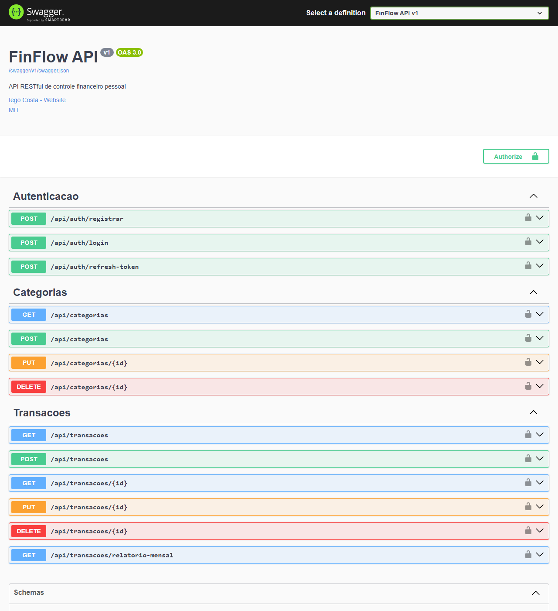

# FinFlow API


[](https://finflow-api-9v36.onrender.com)

API RESTful de controle financeiro pessoal desenvolvida em C# com ASP.NET Core 8.

---

## 🚀 Demonstração online

**Swagger:** https://finflow-api-9v36.onrender.com

Use a conta de demonstração para testar sem precisar se cadastrar:

| E-mail | Senha |
|---|---|
| `teste.deploy@finflow.com` | `Senha@123` |

1. Faça login em `POST /api/auth/login` e copie o `token` da resposta
2. Clique em **Authorize** e cole o token
3. Teste os endpoints de categorias, transações e relatório mensal

> ⏳ A API está no plano gratuito do Render e hiberna após um período sem acesso. A primeira requisição pode levar cerca de 50 segundos; as seguintes são imediatas.



---

## Funcionalidades

- Autenticação com JWT Bearer Token e Refresh Token
- Cadastro e gerenciamento de categorias financeiras por usuário
- Registro e consulta de transações (receitas e saídas) com filtros e paginação
- Relatório mensal com totais por categoria e saldo do período
- Documentação interativa via Swagger
- Testes unitários com xUnit, Moq e FluentAssertions

---

## Stack

| Tecnologia | Versão |
|---|---|
| C# / .NET | 8.0 |
| ASP.NET Core Web API | 8.0 |
| Entity Framework Core | 8.0 |
| PostgreSQL | 16 |
| BCrypt.Net | 4.0 |
| FluentValidation | 11.9 |
| xUnit + Moq + FluentAssertions | — |
| Docker + Docker Compose | — |
| GitHub Actions | — |

---

## Estrutura do Projeto

```
finflow-api/
├── src/
│   ├── FinFlow.API/              ← Controllers, Program.cs, Middlewares
│   ├── FinFlow.Application/      ← Services, DTOs, Interfaces, Validadores
│   ├── FinFlow.Domain/           ← Entidades, Interfaces de Repository, Enums
│   └── FinFlow.Infra/            ← DbContext, Repositories, Migrations
├── tests/
│   └── FinFlow.Tests/            ← xUnit, Moq, FluentAssertions
├── .github/
│   └── workflows/
│       └── ci.yml
├── Dockerfile
├── docker-compose.yml
├── .gitignore
├── LICENSE
└── README.md
```

---

## Como rodar localmente

### Pré-requisitos

- [.NET 8 SDK](https://dotnet.microsoft.com/download/dotnet/8.0)
- [Docker Desktop](https://www.docker.com/products/docker-desktop/)

### Opção 1 — Apenas o banco (recomendado para desenvolvimento)

```bash
# 1. Clone o repositório
git clone https://github.com/iegosoft/finflow-api.git
cd finflow-api

# 2. Suba o PostgreSQL via Docker
docker compose up postgres -d

# 3. Execute a API (as migrations são aplicadas automaticamente na inicialização)
dotnet run --project src/FinFlow.API --launch-profile http
```

Acesse o Swagger em: `http://localhost:5177`

### Opção 2 — Aplicação completa com Docker

```bash
docker compose up --build
```

Acesse o Swagger em: `http://localhost:8080`

### Testando pelo Swagger

1. Crie uma conta em `POST /api/auth/registrar`
2. Faça login em `POST /api/auth/login` e copie o `token` da resposta
3. Clique em **Authorize** e cole o token
4. Use os endpoints de categorias, transações e relatório mensal

---

## Executar os testes

```bash
dotnet test
```

---

## Endpoints

### Autenticação

| Método | Rota | Descrição |
|---|---|---|
| POST | `/api/auth/registrar` | Cria uma nova conta |
| POST | `/api/auth/login` | Retorna JWT + RefreshToken |
| POST | `/api/auth/refresh-token` | Renova o JWT |

### Categorias *(requer JWT)*

| Método | Rota | Descrição |
|---|---|---|
| GET | `/api/categorias` | Lista categorias do usuário |
| POST | `/api/categorias` | Cria uma categoria |
| PUT | `/api/categorias/{id}` | Atualiza uma categoria |
| DELETE | `/api/categorias/{id}` | Remove uma categoria |

### Transações *(requer JWT)*

| Método | Rota | Descrição |
|---|---|---|
| GET | `/api/transacoes` | Lista com filtros e paginação |
| GET | `/api/transacoes/{id}` | Busca por ID |
| POST | `/api/transacoes` | Cria uma transação |
| PUT | `/api/transacoes/{id}` | Atualiza uma transação |
| DELETE | `/api/transacoes/{id}` | Remove uma transação |
| GET | `/api/transacoes/relatorio-mensal` | Relatório mensal por categoria |

---

## Variáveis de ambiente

| Variável | Descrição |
|---|---|
| `ConnectionStrings__Postgres` | String de conexão com o PostgreSQL (aceita formato chave=valor ou URI `postgresql://...`) |
| `Jwt__Chave` | Chave secreta para assinar o JWT |
| `Jwt__Emissor` | Emissor do token |
| `Jwt__Audiencia` | Audiência do token |
| `Jwt__ExpiracaoHoras` | Tempo de expiração do JWT em horas |
| `Jwt__ExpiracaoRefreshTokenDias` | Tempo de expiração do refresh token em dias |
| `Swagger__Habilitado` | Habilita o Swagger fora do ambiente de desenvolvimento |

---

## Deploy

A API é publicada gratuitamente no **[Render](https://render.com)** via `Dockerfile`, com banco PostgreSQL no **[Neon](https://neon.tech)**. A infraestrutura está descrita no Blueprint [`render.yaml`](render.yaml).

1. Crie um projeto no Neon e copie a connection string (`postgresql://...`)
2. No Render, clique em **New → Blueprint** e selecione este repositório
3. Informe a connection string do Neon em `ConnectionStrings__Postgres`
4. A chave JWT é gerada automaticamente pelo Render e as migrations são aplicadas na inicialização

> No plano gratuito, a API hiberna após 15 minutos sem acesso; a primeira requisição seguinte pode levar até um minuto.

---

## Licença

MIT © 2026 [Iego Costa](https://github.com/iegosoft)
